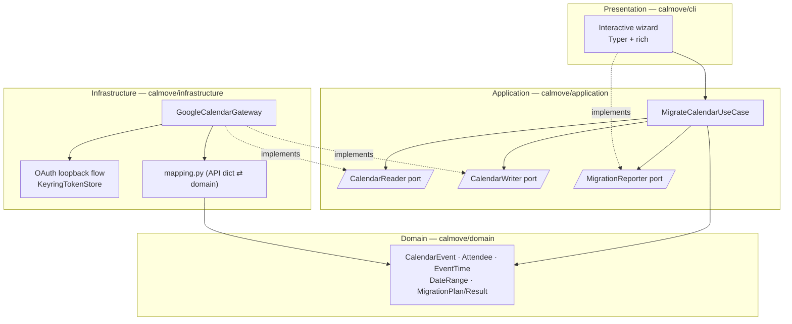
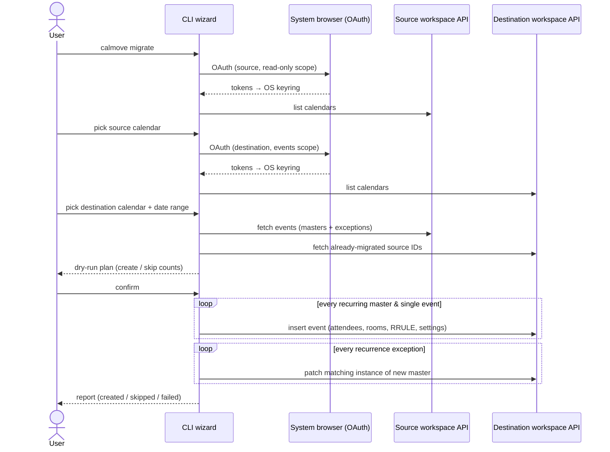
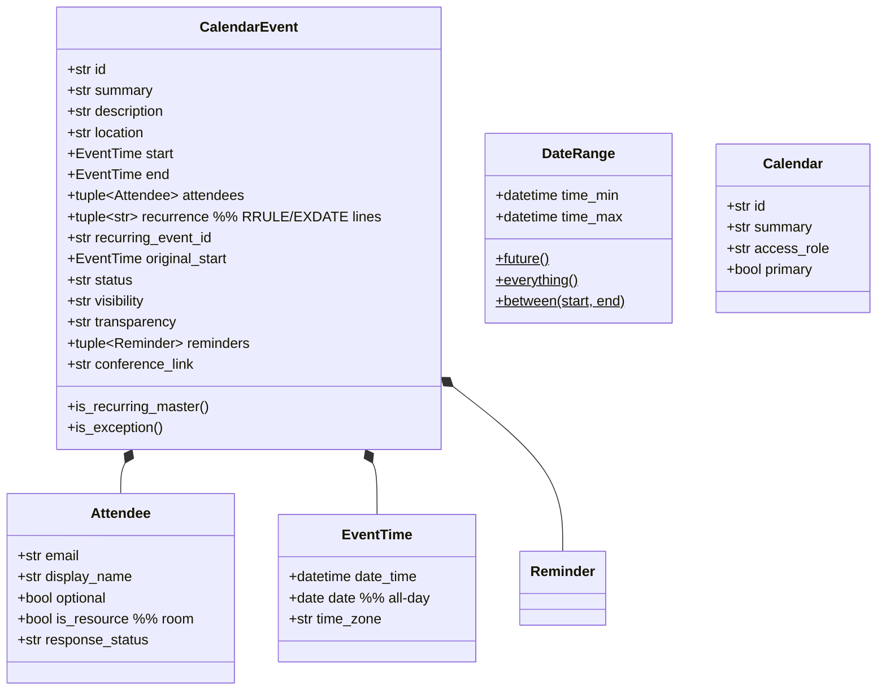
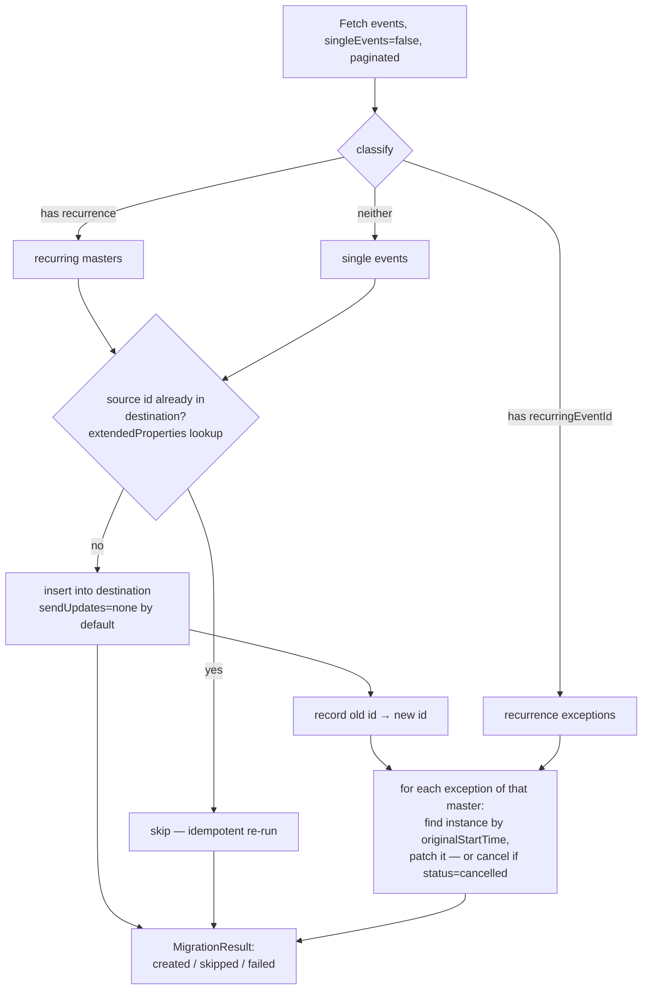

# CalMove — Technical Specification

Cross-workspace Google Calendar migration tool. Re-creates every event from a calendar in an
old Google Workspace as a **new, fully-featured event** in a calendar of a new Google Workspace —
preserving attendees, rooms, recurrences, and event settings that a plain ICS import would lose.

---

## 1. Problem Statement

A plain Google Calendar export/import (ICS) strips:

- invited participants (attendees),
- booked rooms (resource attendees),
- conference/meeting links,
- some recurrence exception details and event metadata.

CalMove instead reads events through the **Google Calendar API** from the source workspace and
re-creates them through the same API in the destination workspace, so the structured data survives.

### User flow (requirement)

1. Log into the **old** workspace → pick the source calendar.
2. Log into the **new** workspace → pick the destination calendar.
3. Pick a date range — explicit `from`/`to` dates, **"from today onward"**, or **"everything"**.
4. Review a migration plan (dry-run summary) and **confirm**.
5. Tool creates new events in the destination calendar; progress + final report.

---

## 2. Technology Decision

| Option | Pros | Cons | Verdict |
|---|---|---|---|
| **Python 3.12 CLI** (Typer + google-api-python-client) | First-class Google OAuth/API libraries; `keyring` gives native secure token storage on both macOS (Keychain) and Windows (Credential Manager); trivial distribution via `pipx`/`uv`; easy to test | Terminal UI, not a window | ✅ **chosen** |
| Electron / Tauri GUI | Friendly UI | Large attack surface, heavy build pipeline, OAuth in embedded browsers is discouraged by Google | rejected |
| Go CLI | Single static binary | Weaker Google client ergonomics, slower iteration, less approachable for maintainers | rejected |

The CLI is interactive (guided prompts, colored output via `rich`), so non-expert users still get a
step-by-step wizard. OAuth happens in the **system browser** (loopback flow) — the recommended,
phishing-resistant pattern for installed apps.

**Stack:** Python ≥ 3.12 · Typer (CLI) · rich (terminal UI) · google-api-python-client +
google-auth-oauthlib (Calendar API & OAuth) · keyring (OS-native token storage) · pytest (tests) ·
ruff (lint + format) · mypy --strict (types) · uv (package manager).

---

## 3. Architecture — Clean Architecture

Dependencies point strictly inward. The domain knows nothing about Google; the application layer
talks to abstract ports; only the infrastructure layer imports Google SDKs.



| Layer | Package | May import |
|---|---|---|
| Domain | `calmove/domain` | stdlib only |
| Application | `calmove/application` | domain |
| Infrastructure | `calmove/infrastructure` | application ports, domain, Google SDKs, keyring |
| Presentation | `calmove/cli` | application, domain, infrastructure (composition root) |

---

## 4. End-to-End Flow



---

## 5. Domain Model



All domain types are **immutable frozen dataclasses** — pure data + behavior, zero I/O.

---

## 6. Migration Algorithm



Key behaviors:

- **Idempotency** — every created event carries
  `extendedProperties.private["calmove-source-id"] = <old event id>`. Re-running the migration
  skips already-migrated events, so interrupted runs can simply be resumed.
- **Recurrences** — masters are migrated with their verbatim `RRULE`/`RDATE`/`EXDATE` lines.
  Modified/cancelled occurrences (exceptions) are then applied by patching the matching instance
  (`originalStartTime`) of the newly created master.
- **Order** — masters before exceptions; failures on one event never abort the run (collected in
  the report).
- **Notifications** — `sendUpdates=none` by default so hundreds of migrated meetings do not spam
  every attendee with invitations; `--send-updates all` opts in.
- **Rooms** — resource attendees are carried over. Because room resource e-mail addresses differ
  between workspaces, an optional JSON **room map** (`--room-map rooms.json`,
  `{"old-room@resource.calendar.google.com": "new-room@..."}`) translates them; unmapped rooms are
  kept verbatim and flagged in the report.
- **Date range** — applied server-side via `timeMin`/`timeMax`; presets map to
  `DateRange.future()` (today → ∞), `DateRange.everything()`, or `DateRange.between(a, b)`.

### Known, unavoidable limitations (documented to the user)

| Item | Behavior |
|---|---|
| Google Meet links | Cannot be transferred across workspaces. CalMove requests a **fresh** Meet conference on the new event and appends the old link to the description for reference. |
| Organizer | The migrating user becomes organizer of the new events (API constraint). |
| Attendee RSVP status | Sent best-effort; Google may reset it to `needsAction`. |
| Shared calendars | Destination write requires `writer`/`owner` access role (validated before migration). |

---

## 7. Security Design

- **OAuth 2.0 installed-app loopback flow** (`http://127.0.0.1:<random port>`) in the *system*
  browser with **PKCE** — no embedded webviews, no password handling, ever.
- **Least-privilege scopes**: source login uses `calendar.readonly` only; destination login uses
  `calendar.events` + `calendar.readonly` (calendar listing). The tool is physically unable to
  modify the old workspace.
- **Token storage**: refresh/access tokens go into the OS keychain via `keyring`
  (macOS Keychain, Windows Credential Manager) — never plaintext files. `calmove logout` wipes them.
- **No secrets in repo**: users supply their own OAuth *Desktop* client (`client_secret.json`,
  path via `--client-secret` or `CALMOVE_CLIENT_SECRET` env var); `.gitignore` blocks
  `client_secret*.json` and token files.
- **Read-only until confirmation**: all API writes happen strictly after the explicit user
  confirmation step; `--dry-run` performs the full plan with zero writes.
- Dependencies pinned via lockfile; CI runs lint, strict type-check, tests, and `pip-audit`.

---

## 8. Repository Layout

```
CalMove/
├── src/calmove/
│   ├── domain/            # model.py, date_range.py, errors.py   (pure, stdlib-only)
│   ├── application/       # ports.py, migrate_calendar.py        (use case + ports)
│   ├── infrastructure/
│   │   └── google/        # auth.py, gateway.py, mapping.py      (OAuth, API, dict⇄domain)
│   └── cli/               # main.py, prompts.py                  (Typer wizard, composition root)
├── tests/
│   ├── unit/              # domain, use case (with in-memory fakes), mapping round-trips
│   └── conftest.py
├── docs/SPECIFICATION.md  # this file
├── CONSTITUTION.md        # architectural constitution (binding rules)
├── AGENTS.md              # repository guidelines for AI assistants
└── pyproject.toml         # uv-managed; ruff, mypy, pytest config
```

## 9. Testing Strategy

- **Domain & use case**: pure unit tests; the use case is exercised against in-memory fake
  `CalendarReader`/`CalendarWriter` implementations — covers idempotent skips, master/exception
  ordering, cancelled occurrences, room mapping, failure isolation, dry-run.
- **Mapping**: round-trip tests `Google API dict → CalendarEvent → API dict` for timed, all-day,
  recurring, and exception events.
- **No live-API tests** in CI; the Google gateway stays thin so everything above it is testable
  offline.
