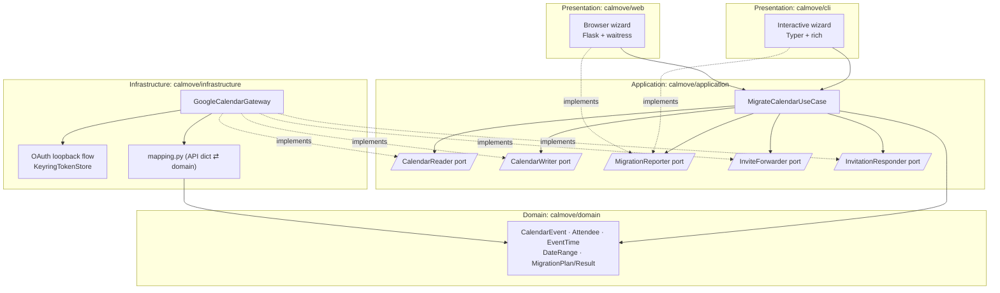
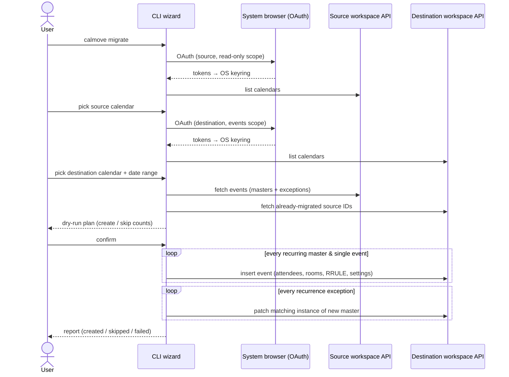
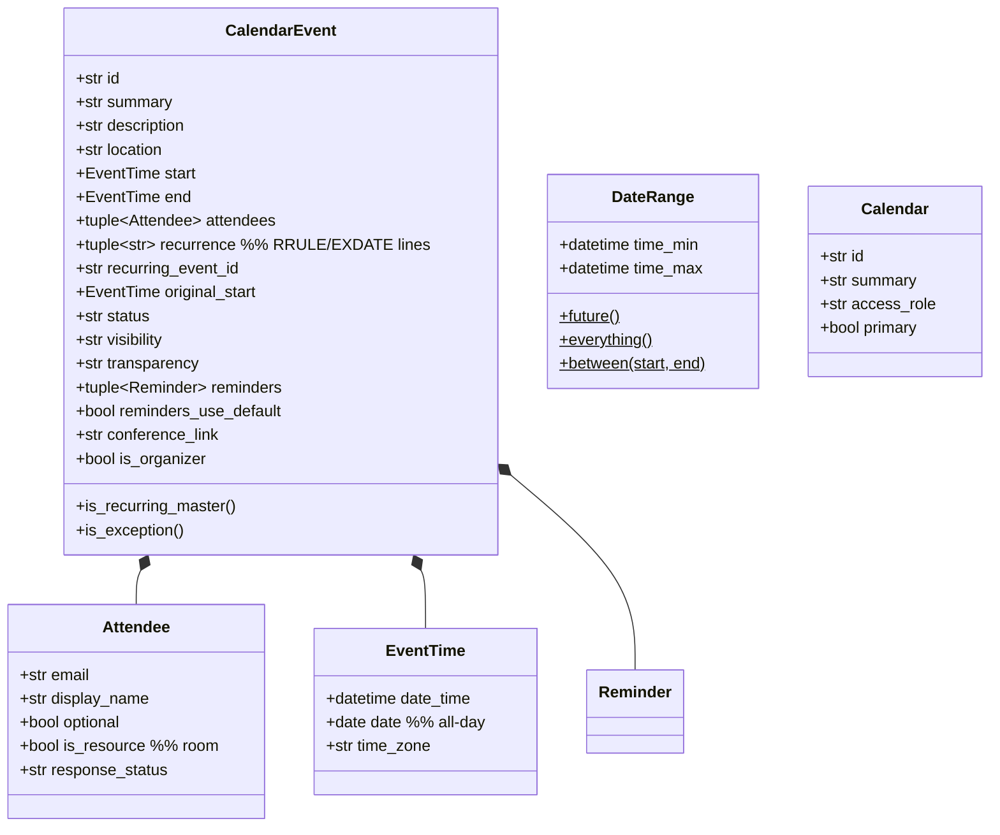
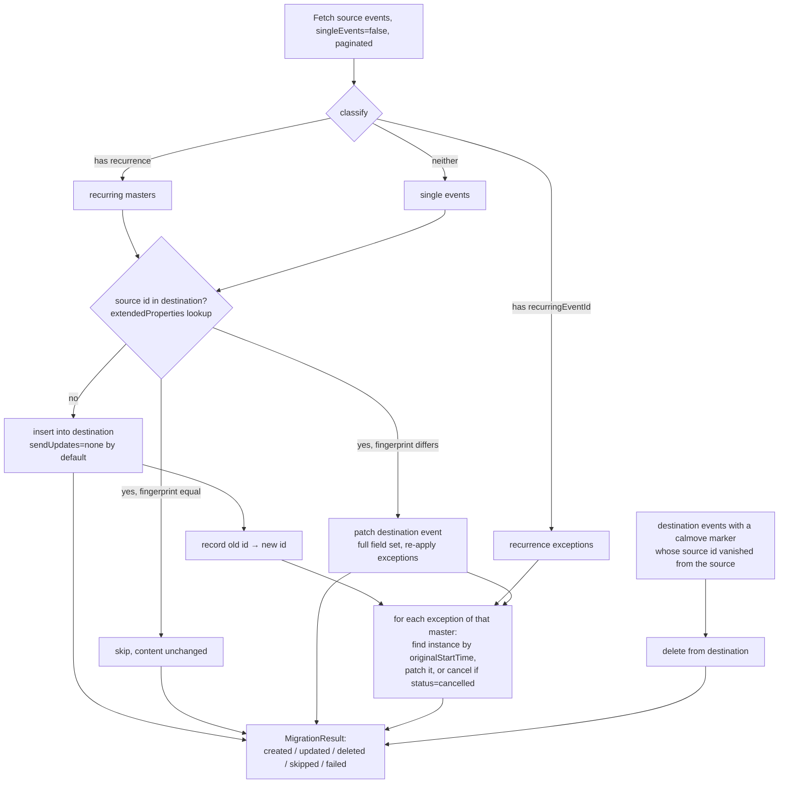

# CalMove Technical Specification

Cross-workspace Google Calendar migration tool. Re-creates every event from a calendar in an
old Google Workspace as a new, fully-featured event in a calendar of a new Google Workspace,
preserving attendees, rooms, recurrences, and event settings that a plain ICS import would lose.

---

## 1. Problem Statement

A plain Google Calendar export/import (ICS) strips:

- invited participants (attendees),
- booked rooms (resource attendees),
- conference/meeting links,
- some recurrence exception details and event metadata.

CalMove instead reads events through the Google Calendar API from the source workspace and
re-creates them through the same API in the destination workspace, so the structured data survives.

### User flow (requirement)

1. Log into the old workspace → pick the source calendar.
2. Log into the new workspace → pick the destination calendar.
3. Pick a date range: explicit `from`/`to` dates, "from today onward", or "everything".
4. Review a migration plan (dry-run summary) and confirm.
5. Tool creates new events in the destination calendar; progress + final report.

---

## 2. Technology Decision

| Option | Pros | Cons | Verdict |
|---|---|---|---|
| Python 3.12 CLI (Typer + google-api-python-client) | First-class Google OAuth/API libraries; `keyring` gives native secure token storage on both macOS (Keychain) and Windows (Credential Manager); trivial distribution via `pipx`/`uv`; easy to test | Terminal UI, not a window | ✅ chosen |
| Electron / Tauri GUI | Friendly UI | Large attack surface, heavy build pipeline, OAuth in embedded browsers is discouraged by Google | rejected |
| Go CLI | Single static binary | Weaker Google client ergonomics, slower iteration, less approachable for maintainers | rejected |

The CLI is interactive (guided prompts, colored output via `rich`), so non-expert users still get a
step-by-step wizard. OAuth happens in the system browser (loopback flow), the recommended
phishing-resistant pattern for installed apps.

Stack: Python ≥ 3.12 · Typer (CLI) · rich (terminal UI) · google-api-python-client +
google-auth-oauthlib (Calendar API & OAuth) · keyring (OS-native token storage) · pytest (tests) ·
ruff (lint + format) · mypy --strict (types) · uv (package manager).

---

## 3. Architecture: Clean Architecture

Dependencies point strictly inward. The domain knows nothing about Google; the application layer
talks to abstract ports; only the infrastructure layer imports Google SDKs.



| Layer | Package | May import |
|---|---|---|
| Domain | `calmove/domain` | stdlib only |
| Application | `calmove/application` | domain |
| Infrastructure | `calmove/infrastructure` | application ports, domain, Google SDKs, keyring |
| Presentation | `calmove/cli` | application, domain, infrastructure (composition root) |

---

## 4. End-to-End Flow



---

## 5. Domain Model



All domain types are immutable frozen dataclasses: pure data + behavior, zero I/O.

---

## 6. Migration Algorithm (synchronizing re-runs)



Key behaviors:

- Synchronizing idempotency: every created/updated event carries two private markers:
  `extendedProperties.private["calmove-source-id"] = <old event id>` and
  `["calmove-fingerprint"] = sha256(<canonical serialization of the mapped event and its
  exceptions>)`. A re-run compares the fingerprint recomputed from the *source* against the
  stored one:
  - unchanged → skipped, the destination copy is not touched;
  - changed → the destination event is patched in place (full field set, including
    clearing attendees/recurrence removed at the source; a fresh Meet conference is *not*
    re-requested) and its exceptions are re-applied;
  - new → created as before;
  - deleted at the source → the destination copy (identified by its `calmove-source-id`
    marker, within the same date range) is deleted. Events the user created directly in the
    destination calendar carry no marker and are never touched.
  Events migrated by pre-fingerprint versions of CalMove are updated once (their fingerprint
  is unknown), then skip normally. Interrupted runs can be resumed.
- Organizer distinction & invitation forwarding: events are partitioned by
  `organizer.self`:
  - Owned events (user is the organizer) go through the create/update/delete sync above:
    the user rightfully re-creates them, including rooms and a fresh Meet conference.
  - Invited events (someone else organizes) are never copied, because a copy would re-book
    rooms and fork the organizer's meeting. Instead CalMove *forwards the invitation*: it
    appends the chosen destination calendar's address to the guest list of the user's
    copy of the event in the old calendar (the API equivalent of "Add guests"). For a
    personal migration the destination is the primary calendar, whose address *is* the new
    account, so the user becomes a real attendee of the organizer's live event; for a group
    calendar migration the new group calendar itself is invited, so the meeting lands on
    it for the whole team. Rooms, Meet link, and future organizer edits are included either
    way. Idempotent by membership: if the forward address is already on the guest list, the
    event is skipped and never touched again (a later manual RSVP change is respected).
    Right after a successful forward, and only when the destination is the primary
    calendar (calendars don't RSVP; people do), the new account's RSVP is set to mirror
    the old account's response (accepted/tentative/declined; an unanswered invite stays
    unanswered). Requires the organizer's `guestsCanInviteOthers` (Google default: on);
    otherwise the event lands in the failure report. Shadow copies created by
    pre-forwarding CalMove versions carry the marker but no longer match an owned source
    event, so the deletion pass cleans them up automatically.
- Recurrences: masters are migrated with their verbatim `RRULE`/`RDATE`/`EXDATE` lines.
  Modified/cancelled occurrences (exceptions) are then applied by patching the matching instance
  (`originalStartTime`) of the newly created master.
- Order: masters before exceptions; failures on one event never abort the run (collected in
  the report).
- Notifications: `sendUpdates=none` by default so hundreds of migrated meetings do not spam
  every attendee with invitations. Opting in: CLI `--send-updates all`; the web wizard offers
  a "send invitation e-mails" checkbox on the confirmation step. Because events migrated in
  an earlier silent run are skipped as unchanged, the opt-in also enables **re-send mode**
  (`resend_invitations`): owned events whose fingerprint matches are patched with identical
  content and `sendUpdates=all`, which makes Google deliver the invitations without changing
  any event data. Invited events are unaffected (the organizer's event already carries its
  own guest notifications).
- Rooms: resource attendees are carried over. Because room resource e-mail addresses differ
  between workspaces, an optional JSON room map (`--room-map rooms.json`,
  `{"old-room@resource.calendar.google.com": "new-room@..."}`) translates them; unmapped rooms are
  kept verbatim and flagged in the report.
- Attendee address mapping: when the whole organization changes domain (e.g. a temporary
  move `@old-company.com` → `@new-company.com`), attendee addresses on owned events are rewritten
  during migration so events appear directly in colleagues' new calendars without any
  invitation e-mails (`sendUpdates=none`). Two tiers, precedence explicit > domain > unchanged:
  - domain rules (`--map-domain old-company.com=new-company.com`, repeatable; web:
    `CALMOVE_WEB_DOMAIN_MAP="old-company.com=new-company.com,…"`): rewrite the domain, keep the
    local part; matching is case-insensitive;
  - explicit entries (`--attendee-map attendees.json`, web: `CALMOVE_WEB_ATTENDEE_MAP`):
    full old → new address pairs for people whose local part changes.
  Only human attendees are mapped (rooms stay governed by the room map); addresses outside
  the mapped domains (externals) pass through untouched; `displayName`, `optional`, and the
  RSVP are preserved. The fingerprint is computed on the *mapped* event, so changing the map
  later patches events in place (same event ids, no re-invitations); the return journey of a
  temporary domain move requires no map change when IT re-attaches the old domain to the
  workspace, and one reversed rule otherwise.
- Date range: applied server-side via `timeMin`/`timeMax`; presets map to
  `DateRange.future()` (today → ∞), `DateRange.everything()`, or `DateRange.between(a, b)`.
  A custom To-date is inclusive: it is implemented by adding one day to the exclusive
  `timeMax`.

### Known, unavoidable limitations (documented to the user)

| Item | Behavior |
|---|---|
| Google Meet links | Cannot be transferred across workspaces. CalMove requests a fresh Meet conference on the new event and appends the old link to the description for reference. |
| Organizer | The migrating user becomes organizer of the new events (API constraint). |
| Attendee RSVP status | Sent best-effort; Google may reset it to `needsAction`. |
| Shared calendars | Destination write requires `writer`/`owner` access role (validated before migration). |
| Removed recurrence exceptions | An exception deleted at the source (occurrence restored to series default) is not reverted on the destination by a re-run; re-create the event or fix the occurrence manually. |

---

## 7. Security Design

- OAuth 2.0 installed-app loopback flow (`http://127.0.0.1:<random port>`) in the *system*
  browser with PKCE: no embedded webviews, no password handling.
- Least-privilege scopes: source login uses `calendar.readonly` +
  `calendar.events.owned` (read everything, but write only to calendars the user owns),
  used for exactly one operation: appending the new address to an invited event's guest
  list (§6 forwarding). Destination login uses `calendar.events` + `calendar.readonly`
  (calendar listing). The tool can never touch other people's calendars in the old
  workspace.
- Token storage: CLI mode puts refresh/access tokens into the OS keychain via `keyring`
  (macOS Keychain, Windows Credential Manager), never plaintext files; `calmove logout` wipes
  them. Web mode (§10) holds tokens only in server RAM, scoped to one browser session.
- No secrets in repo: users supply their own OAuth *Desktop* client (`client_secret.json`,
  path via `--client-secret` or `CALMOVE_CLIENT_SECRET` env var); `.gitignore` blocks
  `client_secret*.json` and token files.
- Read-only until confirmation: all API writes happen strictly after the explicit user
  confirmation step; `--dry-run` performs the full plan with zero writes.
- Dependencies pinned via lockfile; CI runs lint, strict type-check, tests, and `pip-audit`.

---

## 8. Repository Layout

```
CalMove/
├── src/calmove/
│   ├── domain/            # model.py, date_range.py, errors.py   (pure, stdlib-only)
│   ├── application/       # ports.py, migrate_calendar.py        (use case + ports)
│   ├── infrastructure/
│   │   └── google/        # auth.py, gateway.py, mapping.py      (OAuth, API, dict⇄domain)
│   ├── cli/               # main.py, prompts.py                  (Typer wizard, composition root)
│   └── web/               # main.py, sessions.py, templates/     (Flask wizard, composition root)
├── tests/
│   ├── unit/              # domain, use case (with in-memory fakes), mapping round-trips
│   └── conftest.py
├── docs/SPECIFICATION.md  # this file
├── CONSTITUTION.md        # architectural constitution (binding rules)
├── AGENTS.md              # repository guidelines for AI assistants
├── Dockerfile             # stateless web-service image (uv + waitress)
└── pyproject.toml         # uv-managed; ruff, mypy, pytest config
```

## 9. Testing Strategy

- Domain & use case: pure unit tests; the use case is exercised against in-memory fake
  `CalendarReader`/`CalendarWriter` implementations; covers idempotent skips, master/exception
  ordering, cancelled occurrences, room mapping, failure isolation, dry-run.
- Mapping: round-trip tests `Google API dict → CalendarEvent → API dict` for timed, all-day,
  recurring, and exception events.
- No live-API tests in CI; the Google gateway stays thin so everything above it is testable
  offline.

## 10. Web Deployment Mode (Docker)

A second presentation layer, `calmove/web`, serves the same wizard as a browser flow for staff
who cannot install software. It reuses the use case, ports, gateway, and mapping unchanged.

### Privacy requirements (binding, Constitution art. 6)

1. Per-user OAuth only. Each migration runs exclusively under the OAuth grants of the user
   driving that browser session: sign in to the old workspace (`calendar.readonly`), then the
   new one (`calendar.events` + `calendar.readonly`). The service never holds admin,
   service-account, or domain-wide-delegation credentials.
2. Nothing persisted. Tokens, calendar lists, and event data live only in process memory
   inside a per-session object. No database, no files, no event data in logs. Sessions are
   erased on completion ("Finish" button) or after a 30-minute idle TTL.
3. Session isolation. State is keyed by a 256-bit random session ID in an `HttpOnly`,
   `SameSite=Lax` cookie; there is no listing, sharing, or admin view of sessions. One user can
   never reach another session's state.

### Flow

```mermaid
sequenceDiagram
    actor U as User (browser)
    participant W as CalMove web (Docker)
    participant G as Google OAuth
    U->>W: GET / (Start)
    W->>U: session cookie, redirect to source login
    U->>G: authorization (PKCE, readonly scope)
    G->>W: /oauth/callback?code; tokens into session RAM
    U->>W: pick source calendar
    U->>G: authorization (PKCE, events scope)
    G->>W: /oauth/callback?code
    U->>W: pick destination calendar, date range
    W->>U: dry-run plan (read-only)
    U->>W: type "migrate" to confirm
    W->>W: background thread runs use case
    U->>W: /progress (auto-refresh) → report → Finish erases session
```

### Implementation constraints

- OAuth web-application client (not Desktop): redirect URI `<CALMOVE_WEB_BASE_URL>/oauth/callback`,
  PKCE enabled, consent screen *External* so accounts from both workspaces can sign in. The web
  flow lives in `infrastructure/google/auth.py` beside the loopback flow.
- Single process, threaded server (`waitress`): the in-memory session store forbids
  multi-process workers. Scale-out would require shared session state and is out of scope.
- Configuration (env only): `CALMOVE_WEB_CLIENT_SECRET` (path to the web client JSON,
  mounted as a Docker secret; defaults to `/app/client_secret.json` when the secret was baked
  into the image at build time), `CALMOVE_WEB_BASE_URL` (external HTTPS URL), optional
  `CALMOVE_WEB_ROOM_MAP` (room-map JSON path), `CALMOVE_WEB_ATTENDEE_MAP` (attendee-map JSON
  path), `CALMOVE_WEB_DOMAIN_MAP` (`old=new[,old=new…]` domain rules),
  `CALMOVE_WEB_PORT` (default 8080).
- Writes only after confirmation: the plan step is a dry run; the real run starts only
  after the user types `migrate` (same contract as the CLI). `sendUpdates` is fixed to `none`.
- CSRF: every state-changing POST carries a per-session token (constant-time compared);
  `/start` and `/login/<role>` additionally reject `Sec-Fetch-Site: cross-site` navigations;
  OAuth callbacks validate the `state` parameter against the session.
- Hardening: every response carries `Content-Security-Policy` (deny-by-default,
  `frame-ancestors 'none'`), `X-Frame-Options: DENY`, `X-Content-Type-Options: nosniff`,
  `Referrer-Policy: no-referrer`. The session store caps live sessions (default 1000) and
  answers 503 beyond it; the migrate confirmation transitions session state atomically so a
  double submit cannot start two runs.
- Deployment: TLS terminates at the reverse proxy in front of the container; the proxy
  MUST scrub query strings of `/oauth/callback` from access logs (the single-use PKCE-bound
  authorization code arrives there). The container runs as a non-root user, has no volumes,
  and logs only lifecycle lines (never event data).
